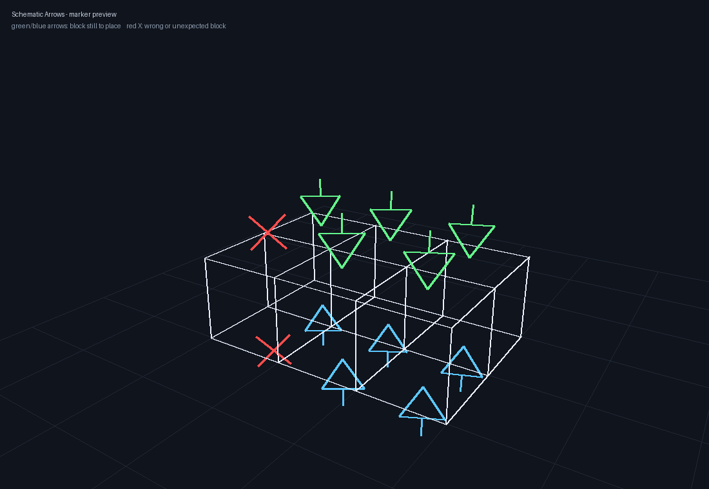

# Schematic Arrows · 原理图箭头

Minecraft **1.21.11** · Fabric · 纯客户端 mod

在用 Litematica 打印原理图时，把**背包里已有材料、但世界里还没放好**的方块标出来：
每个目标方块的正上方画一个向下的箭头、正下方画一个向上的箭头，箭头尖端正好对着方块；
**放错的方块**（该放 A 却放了 B、朝向不对，或者该是空气却多出一个方块）则用红色的 X 标出来。
按一个键就能整体开 / 关。



> 上图是同一套几何的离线预览（软件渲染），不是游戏截图。

下载：[Releases](https://github.com/CNGM222/schematic-arrows/releases) · 源码：[GitHub](https://github.com/CNGM222/schematic-arrows)

## 它怎么工作

1. 读取 Litematica 当前所有启用中的投影（Placement），拿到每个子区域的包围盒；
2. 把包围盒裁剪到玩家周围（默认水平 24 格、垂直 ±12 格），逐格对比**投影世界里应有的方块**和**世界里的方块**；
3. 分成三类：
   - **待放置**：投影要方块、世界是空气 → 背包里有对应物品时，上下画绿/蓝箭头；
   - **放错**：投影要方块、世界也是方块但不一致（换了方块或换了朝向）→ 画红 X；
   - **多余**：投影是空气、世界却有方块（打印时延迟导致放歪）→ 画橙 X；
4. 空气、流体和没有对应物品的方块会被跳过；
5. 按距离排序分别限量（待放置最多 96 个、错误最多 64 个），每帧渲染一次。

因为读的是 Litematica 自己的“投影世界”，旋转、镜像、子区域偏移都已经由 Litematica 处理好了，
不需要自己算坐标变换。

### 扫描是“按区块缓存 + 变了才重扫”

- 每个 16×16 区块的扫描结果都缓存起来，**不会因为转视角、走路而重扫**；
- 只有这几种情况才会重扫某个区块：区块进入扫描范围、区块里有方块变化（打印/手动放置/破坏）、
  投影或设置改变、玩家高度变化超过阈值、以及一个很久才会触发一次的兜底刷新；
- 方块变化通过一个很轻的 mixin 挂在 `ClientWorld#handleBlockUpdate` 上，只有真正收到方块更新时才标记区块脏；
- 每 tick 最多重扫 `chunksPerTick`（默认 2）个区块，单次扫描还有坐标上限，所以不会出现一次性卡顿；
- 站着不动、或者只是转视角时，这个 mod 每 tick 只做几次哈希查找，CPU 占用可以忽略。

## 安装

需要的 mod（全部放在 `mods/`）：

| 依赖 | 版本 |
| --- | --- |
| Fabric Loader | ≥ 0.18.0（推荐 0.18.4+） |
| Fabric API | 0.141.6+1.21.11 |
| MaLiLib | 1.21.11-0.27.20 |
| Litematica | 1.21.11-0.26.16 |
| Litematica Printer | 你平时自动放置用的那个版本 |
| 本 mod | `schematic-arrows-1.3.0.jar` |

启动游戏即可：**V** 开关箭头，**右 Shift** 打开设置界面（两个键都能在“选项 → 控制 → 按键绑定 → 原理图箭头”里改）。

## 使用

1. 用 Litematica 载入 `.litematic` 并放置投影；
2. **确认投影渲染是开着的**（Litematica 菜单里 Schematic Rendering）——投影世界没渲染就读不到方块数据；
3. 把要用的材料放进背包；
4. 按 **V**，动作栏提示“原理图箭头：开”；
5. 未放置、且材料齐全的方块上下就会出现箭头；放好一个，箭头下一次刷新时消失；
6. 再按 **V** 关闭。

## 图形化设置

按 **右 Shift** 打开“原理图箭头设置”，所有参数都在界面里，改完点“完成”（或按 Esc）自动写回
`config/schematic-arrows.json`，改动在关掉界面之前就能看到效果：

- **范围与刷新**：水平 / 垂直扫描半径、最大箭头数量、每 tick 扫描区块数、自动全量重扫间隔、是否只处理选中的投影
- **箭头外观**：宽度、长度、杆长、离方块的间隙、浮动幅度、线条粗细——都是滑块
- **颜色**：上 / 下箭头颜色、是否描边、描边颜色——点一下在预设色之间切换（绿 / 蓝 / 青 / 黄 / 橙 / 红 / 粉 / 白）
- **错误标记**：是否标出放错 / 多余的方块、错误标记数量上限、X 标记大小、两种错误各自的颜色
- **其他**：启动时是否默认开启
- 列表底部有“恢复默认”（一键还原）和“保存并关闭”，右下角的“完成”也会保存并返回

每个选项都有悬停说明；列表是原版的可滚动选项列表，窗口大小 / GUI 缩放变了也不会挤在一起。

## 配置文件（可选）

首次启动会生成 `config/schematic-arrows.json`。用上面的设置界面改最省事；也可以直接编辑这个文件，
保存后按两次 V（关→开）或重进世界生效。

| 字段 | 默认值 | 说明 |
| --- | --- | --- |
| `startEnabled` | `true` | 进游戏时是否默认开启 |
| `horizontalRadius` | `24` | 水平扫描半径（格） |
| `verticalRadius` | `12` | 垂直扫描半径（格） |
| `maxArrows` | `96` | 最多高亮多少方块（最近的优先） |
| `chunksPerTick` | `2` | 每 tick 最多重扫几个区块（默认 2，越大反应越快） |
| `rescanSeconds` | `60` | 兜底全量重扫间隔（秒）；正常只重扫变化的区块 |
| `scanBudget` | `150000` | 单次扫描最多检查多少个坐标（保护性能） |
| `onlySelectedPlacement` | `false` | `true` = 只处理 Litematica 里当前选中的投影 |
| `arrowRadius` | `0.24` | 箭头头的半宽（格） |
| `arrowHeight` | `0.38` | 箭头头长度（格） |
| `arrowStem` | `0.22` | 箭头杆长度（格），设 0 就是纯三角 |
| `arrowGap` | `0.05` | 箭头尖离方块表面的间隙（格） |
| `bobAmplitude` | `0.07` | 上下浮动幅度，设 0 关闭动画 |
| `lineWidth` | `2.5` | 线条粗细 |
| `aboveColor` | `0xFF63F58B` | 上方箭头颜色（ARGB） |
| `belowColor` | `0xFF5BC8FF` | 下方箭头颜色（ARGB） |
| `drawBox` | `true` | 是否给目标方块画一圈描边 |
| `boxColor` | `0x66FFFFFF` | 描边颜色（ARGB，前两位是透明度） |
| `showWrongBlocks` | `true` | 标出与投影不一致的方块（红 X） |
| `showExtraBlocks` | `true` | 标出投影要求空气却多出来的方块（橙 X） |
| `wrongColor` | `0xFFFF4D4D` | 放错方块的 X 颜色（ARGB） |
| `extraColor` | `0xFFFFAA33` | 多余方块的 X 颜色（ARGB） |
| `maxBadMarkers` | `64` | 最多同时标出多少个错误方块 |
| `badMarkerSize` | `0.20` | X 标记的一半尺寸（格） |

箭头始终朝向玩家（绕竖直轴 billboard），走动时也一眼能看清指向。

颜色字段是**带符号的 32 位整数**（ARGB，前两位十六进制是透明度）。改颜色时可以用计算器把
`0xAARRGGBB` 换算成有符号 int，例如上面的绿色 `0xFF63F58B` 就是 `-10226293`。
`default-config/schematic-arrows.json` 是一份可直接复制的默认配置。

## 行为与限制

- 纯客户端 mod，不改服务端；只要服务器允许客户端 mod 就能用。
- 只扫描玩家附近的区域，远处不显示（性能考虑）；上限见 `horizontalRadius` / `maxArrows`。
- 转视角、走路不会触发重扫；只有区块内容变化、区块进出范围、投影/设置变化或玩家高度变化才会重扫，
  且每 tick 最多扫 `chunksPerTick` 个区块，所以不会出现整帧卡顿。
- 需要投影渲染开启；投影整体隐藏时读不到方块，自然也不会显示箭头。
- 箭头有深度测试，被方块挡住时不会透视显示。
- 判定“未放置”= 世界方块状态与投影状态不是同一个状态；朝向不同也算未完成（正好提醒哪里要修正）。
- 红 X / 橙 X 的判定同样按**方块状态**严格比较：同一种方块但朝向、含水等属性不同也会被标成“放错”。
- “多余方块”只在一个投影的子区域内检查。如果投影直接盖在原有地形上（例如在地面上打印地图画），
  地形本身会被当成“多余”，这时请关掉 `showExtraBlocks`（界面里“标出多余的方块”）。
- 错误标记和待放置标记共用同一轮扫描，所以打开错误检测不会让刷新变慢一倍以上。
- 只有 Litematica 真正加载了投影区块的位置才会参与判定；还没渲染到的区块直接跳过，
  不会因为“读不到投影”就把整片地形误报成多余方块。
- 流体方块（水 / 岩浆）会跳过；含水方块（waterlogged）正常参与。
- 不检查材料数量，只看背包里有没有这个物品。
- 只处理 `Block#asItem()` 能给出物品的方块（普通可放置方块），特殊方块不会显示。

## 从源码构建

需要 JDK 21 与 Gradle 9.9.2。

先把两个只用于编译的 jar 放进 `libs/`（不会被打进成品，也不提交进仓库）：

- Litematica 1.21.11：<https://modrinth.com/mod/litematica>
- MaLiLib 1.21.11：<https://modrinth.com/mod/malilib>

然后：

```bat
build.cmd build
```

`build.cmd` 会优先用本地的 `..\tools\gradle-9.9.2`，没有就用 PATH 里的 `gradle`。

产物：`build/libs/schematic-arrows-1.3.0.jar`

`libs/` 里的 Litematica / MaLiLib jar 只用于编译（`modCompileOnly`），不会被打进成品。

## 目录

- `src/main/java/dev/arrows/schematicarrows/SchematicArrowsClient.java` —— 入口、按键、事件注册
- `src/main/java/dev/arrows/schematicarrows/ArrowManager.java` —— 扫描投影、筛选目标
- `src/main/java/dev/arrows/schematicarrows/ArrowRenderer.java` —— 世界内箭头渲染
- `src/main/java/dev/arrows/schematicarrows/ArrowsConfig.java` —— JSON 配置
- `src/main/java/dev/arrows/schematicarrows/ArrowsConfigScreen.java` —— 图形化设置界面
- `preview-arrows.png` —— 箭头几何预览
